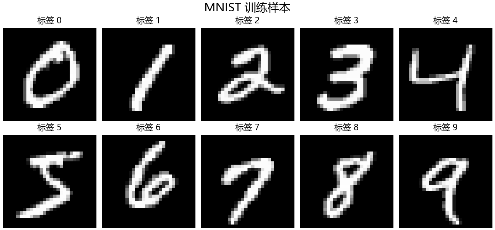
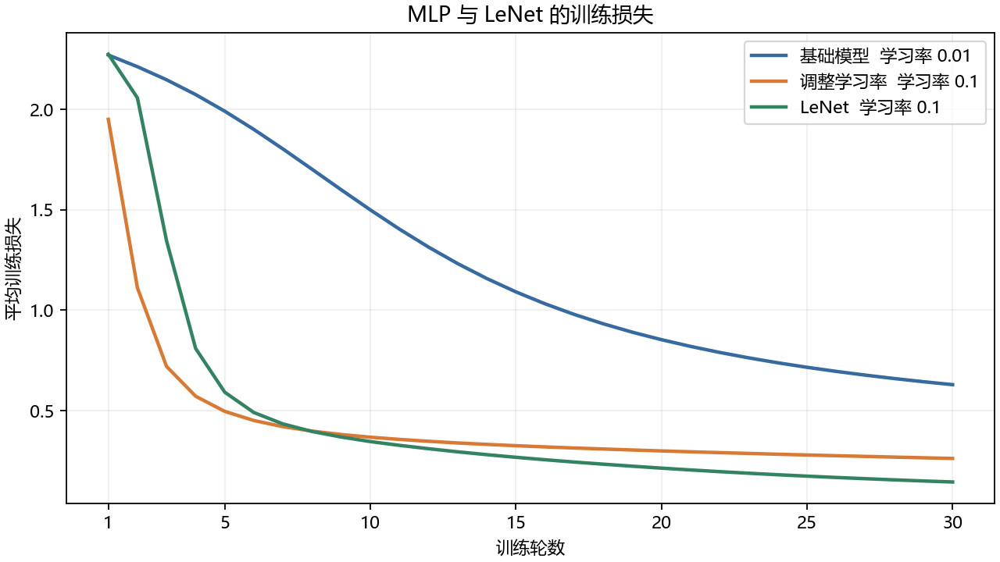
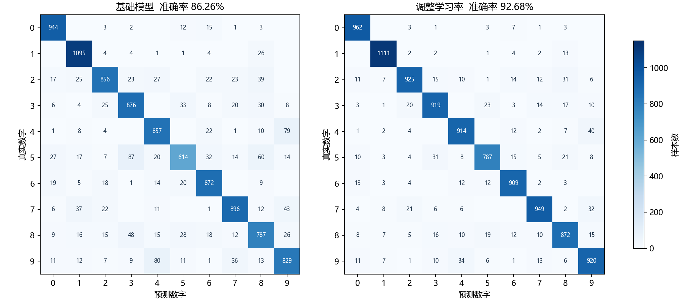
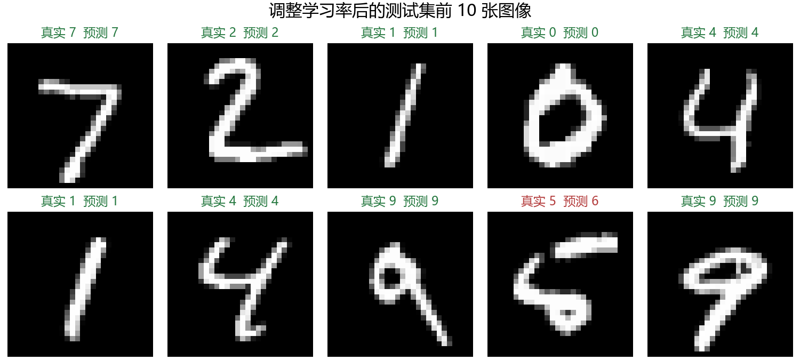
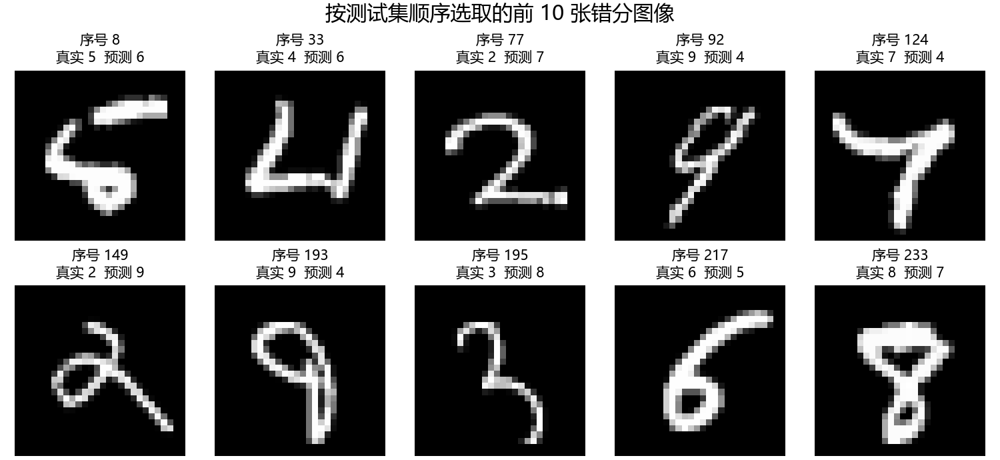
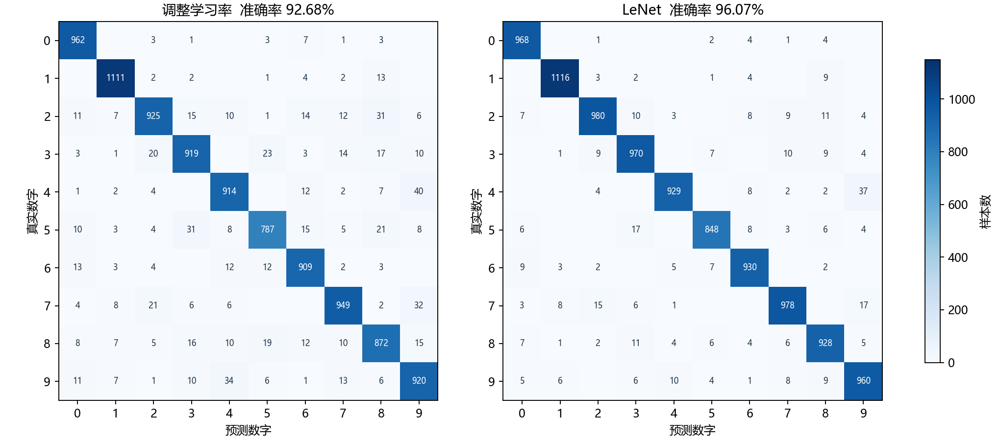
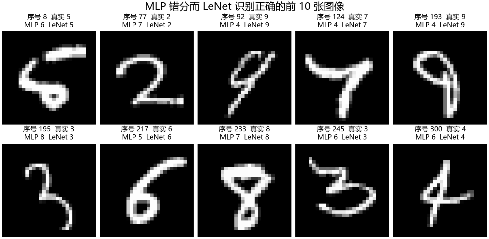

# 实验四 多层感知机手写数字识别

姓名：薛昕瑶　学号：202410315005

## 一、实验目的

用 PyTorch 搭建多层感知机，完成 MNIST 手写数字分类，熟悉数据处理、训练和测试的过程。在此基础上调整学习率，并加入经典 LeNet 架构，比较全连接网络和卷积网络的识别效果。

## 二、数据与实验设置

MNIST 训练集有 60000 张图像，测试集有 10000 张，每张都是 28 × 28 的灰度图，对应数字 0 到 9。输入模型前，将像素除以 255。MLP 使用展开后的 784 维向量，LeNet 将同一张图像还原为二维形式，再在四周各补 2 个零，得到 32 × 32 的输入。训练时打乱样本，测试时保持原有顺序。



基础实验采用参考 PDF 中的设置。两组 MLP 只改变学习率，网络结构和初始权重保持一致。新增 LeNet 与学习率 0.1 的 MLP 比较，三组使用相同的数据划分、每轮样本顺序、批量大小和训练轮数，随机种子均为 42。三组都在训练结束后测试一次，没有根据测试结果选择训练轮数。

| 项目 | 设置 |
| --- | --- |
| MLP 结构 | 784 → 128 → 10 |
| LeNet 结构 | 3 层卷积、2 层平均池化、2 层全连接 |
| 激活函数 | MLP 使用 ReLU，LeNet 使用 Tanh |
| 损失函数 | 交叉熵 |
| 优化器 | SGD |
| 批量大小 | 2048 |
| 训练轮数 | 30 |
| 基础学习率 | 0.01 |
| 对比学习率 | 0.1 |
| LeNet 学习率 | 0.1 |
| 运行环境 | Python 3.13.7、PyTorch 2.11.0、CPU |

## 三、主要实现

### 1. 数据处理

下面直接对数据集中的灰度像素进行处理，效果与参考代码的 ToTensor 一致。训练集和测试集分开读取，测试数据不参与参数更新。

```python
train_data = MNIST("data", train=True, download=True)
test_data = MNIST("data", train=False, download=True)
x_train = train_data.data.reshape(-1, 784).float() / 255.0
x_test = test_data.data.reshape(-1, 784).float() / 255.0
y_train, y_test = train_data.targets, test_data.targets
```

### 2. 定义模型

模型包含两层全连接层，中间用 ReLU 引入非线性，一共有 101770 个可训练参数。输出层给出 10 个类别的得分，得分最大的类别就是预测数字。交叉熵函数内部已经处理了归一化计算，因此输出层不再额外加 Softmax。

```python
class MLP(nn.Module):
    def __init__(self):
        super().__init__()
        self.l1 = nn.Linear(784, 128)
        self.l2 = nn.Linear(128, 10)

    def forward(self, x):
        x = F.relu(self.l1(x))
        return self.l2(x)
```

### 3. LeNet 模型

LeNet 保留 LeNet-5 的经典层次结构，用卷积提取局部笔画特征，再通过平均池化缩小特征图。各层尺寸如下，一共有 61706 个可训练参数。

```text
输入 1 × 32 × 32
→ 卷积 6 × 28 × 28 → 平均池化 6 × 14 × 14
→ 卷积 16 × 10 × 10 → 平均池化 16 × 5 × 5
→ 卷积 120 × 1 × 1 → 全连接 84 → 输出 10
```

本次使用普通 Tanh、固定平均池化和全通道卷积，输出层改为线性分类，统一使用交叉熵。原论文的缩放激活、可训练下采样、部分通道连接和 RBF 输出未逐项复刻。

```python
class LeNet(nn.Module):
    def __init__(self):
        super().__init__()
        self.c1 = nn.Conv2d(1, 6, kernel_size=5)
        self.c3 = nn.Conv2d(6, 16, kernel_size=5)
        self.c5 = nn.Conv2d(16, 120, kernel_size=5)
        self.pool = nn.AvgPool2d(2, 2)
        self.f6 = nn.Linear(120, 84)
        self.output = nn.Linear(84, 10)

    def forward(self, x):
        x = F.pad(x.reshape(-1, 1, 28, 28), (2, 2, 2, 2))
        x = self.pool(torch.tanh(self.c1(x)))
        x = self.pool(torch.tanh(self.c3(x)))
        x = torch.tanh(self.c5(x)).flatten(1)
        x = torch.tanh(self.f6(x))
        return self.output(x)
```

### 4. 模型训练

每个批次先清空梯度，再计算预测结果和损失，随后反向传播并更新参数。每轮的训练损失按样本数加权平均，避免最后一个较小批次影响统计结果。

```python
optimizer = torch.optim.SGD(model.parameters(), lr=lr)
for epoch in range(1, epochs + 1):
    model.train()
    loss_sum = 0.0
    for x, y in train_loader:
        x, y = x.to(device), y.to(device)
        optimizer.zero_grad()
        output = model(x)
        loss = F.cross_entropy(output, y)
        loss.backward()
        optimizer.step()
        loss_sum += loss.item() * len(y)
    train_loss = loss_sum / len(train_set)
```

### 5. 模型测试

测试时切换到评估模式，并关闭梯度计算。准确率用预测正确的总数除以 10000，测试损失也按全部样本平均。

```python
model.eval()
loss_sum, correct = 0.0, 0
with torch.no_grad():
    for x, y in test_loader:
        x, y = x.to(device), y.to(device)
        output = model(x)
        loss_sum += F.cross_entropy(output, y, reduction="sum").item()
        pred = output.argmax(dim=1)
        correct += (pred == y).sum().item()
test_loss = loss_sum / len(test_loader.dataset)
accuracy = correct / len(test_loader.dataset)
```

## 四、实验结果与分析

### 1. 损失变化与测试结果



| 实验 | 参数量 | 最后一轮训练损失 | 测试损失 | 测试准确率 | 错分数量 |
| --- | ---: | ---: | ---: | ---: | ---: |
| MLP 学习率 0.01 | 101770 | 0.6295 | 0.5995 | 86.26% | 1374 |
| MLP 学习率 0.1 | 101770 | 0.2621 | 0.2548 | 92.68% | 732 |
| LeNet 学习率 0.1 | 61706 | 0.1450 | 0.1322 | 96.07% | 393 |

基础模型的损失从 2.2703 降到 0.6295，能够学到数字的主要特征，但下降较慢。学习率改为 0.1 后，第 5 轮损失已经降到 0.4964，低于基础模型第 30 轮的损失。训练结束时，测试准确率提高了 6.42 个百分点，少错分了 642 张图像。

这说明在本次批量大小和训练轮数下，0.01 的学习率偏小，参数更新较慢。0.1 在这次实验中下降平稳、效果更好，但不能由此认为学习率越大越好，也不能把基础模型的结果完全归因于网络层数少。本次只使用一个随机种子，结果还不能代表不同初始化下的平均表现。

### 2. 混淆矩阵



矩阵的行表示真实数字，列表示预测数字，对角线上的数值是预测正确的数量。调整学习率后，数字 5 的正确识别数量从 614 增加到 787，改善比较明显。数字 4 和 9 仍容易混淆，其中 40 张数字 4 被识别为 9，34 张数字 9 被识别为 4。两种数字的部分写法接近，仅靠这个简单网络还不能完全分开。

### 3. 预测示例与错误分析



上图展示测试集前 10 张图像的预测，绿色表示正确，红色表示错误。其中一张真实标签为 5 的图像被识别为 6，其下半部分有比较明显的闭合形状。



错分图按测试集顺序取前 10 张，序号从 0 开始。有些数字存在倾斜、笔画粘连或写法不常见的情况，例如序号 92 的数字 9 被识别为 4。全连接网络直接使用展开后的像素，对笔画位置和形状变化的适应能力有限，下面进一步与 LeNet 比较。

### 4. 与 LeNet 比较

LeNet 在前几轮下降较慢，第 8 轮的训练损失开始低于学习率 0.1 的 MLP。30 轮后，测试准确率达到 96.07%，比该 MLP 提高 3.39 个百分点，错分数量从 732 降到 393。



数字 5 的正确识别数量从 787 增加到 848，数字 9 被错判为 4 的数量从 34 降到 10。不过，数字 4 被错判为 9 仍有 37 张，说明换成卷积网络也没有完全解决相近写法的混淆。



上图按测试集顺序选出 MLP 错分而 LeNet 识别正确的前 10 张图像，其中包括前面提到的序号 8 和 92。逐张比较后，LeNet 正确识别了 386 张 MLP 错分的图像，同时也错分了 47 张 MLP 原本识别正确的图像，净减少 339 张错误。两者都错分的图像有 346 张。

LeNet 通过局部连接和共享卷积核利用图像的空间关系，参数量比 MLP 少 40064，但计算更复杂。本机这次记录的训练与测试总耗时，学习率 0.1 的 MLP 约为 14.3 秒，LeNet 约为 88.5 秒。因此参数少并不等于运行更快。本次比较的是两种完整架构，激活函数等设置也不同，不能把全部提升归因于某一层。

## 五、实验小结

基础 MLP 的测试准确率为 86.26%，调整学习率后达到 92.68%，加入 LeNet 对比后达到 96.07%。本次实验中，合理的学习率改善了训练效果，卷积结构进一步减少了错分，但也增加了计算时间。分析模型时需要结合准确率、错误样本和计算开销，不能只看某一个指标。

## 六、代码与运行方法

[完整 Notebook](mlp_mnist.ipynb) 包含全部代码和本次运行输出，也可以运行 [Python 程序](mlp_mnist.py)。在仓库根目录执行：

```bash
python -m pip install -r requirements.txt
python mlp_mnist.py
```

首次运行会下载 MNIST，之后可直接使用本地数据。运行后会更新 results 目录中的图片和数据。原始数据不上传到仓库。

逐轮训练损失见 [history.csv](results/history.csv)，最终指标见 [summary.csv](results/summary.csv)，环境信息见 [environment.json](results/environment.json)。每张测试图的标签和三组预测保存在 [predictions.npz](results/predictions.npz)，LeNet 与 MLP 的逐样本比较见 [lenet_comparison.json](results/lenet_comparison.json)。

参考资料：教师提供的实验四参考代码 PDF、[往年实验报告](https://github.com/Guyudong1/CV_exp/tree/main/4th.exp)、[LeNet 原论文](https://bottou.org/papers/lecun-98h)。图像和数值均来自本次实际运行。
